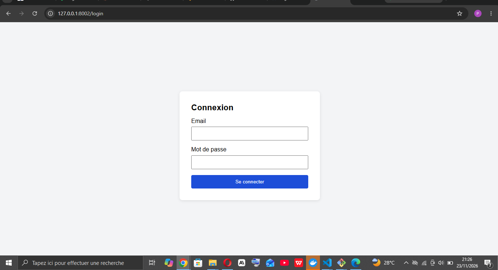
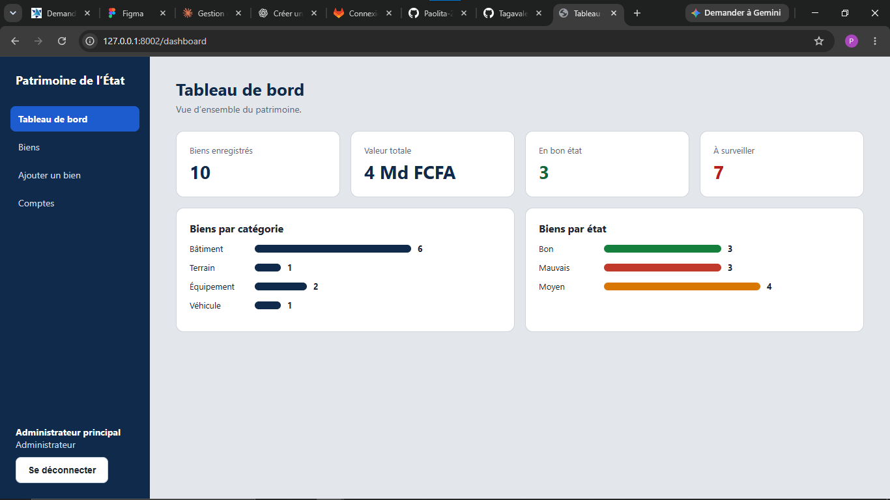
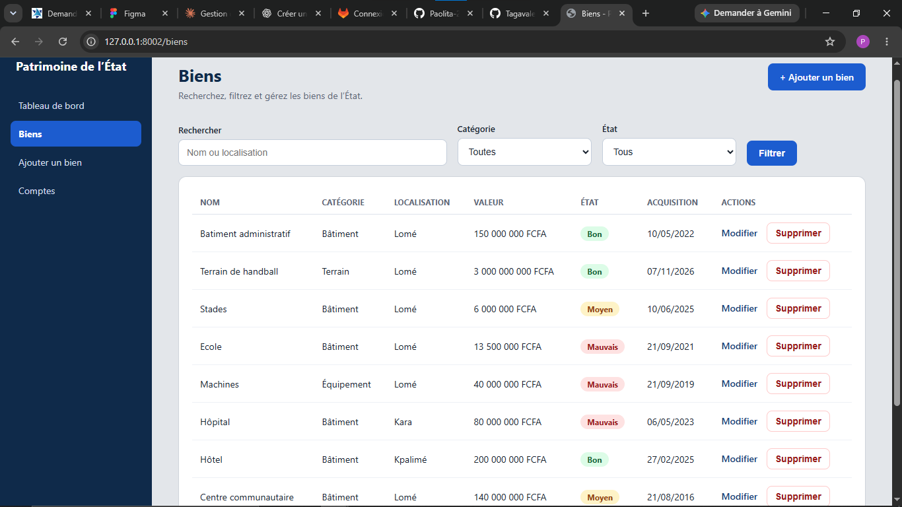
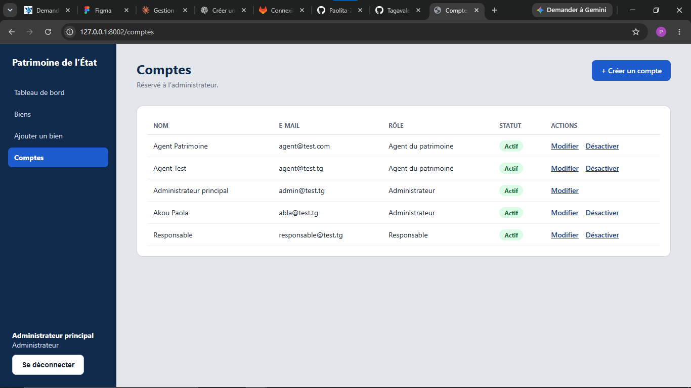

# Guide d'utilisation

Ce guide explique comment utiliser l'application de gestion du patrimoine de l'État.
Adresse : http://127.0.0.1:8002

## 1. Se connecter

1. Ouvrez la page de connexion.
2. Saisissez votre e-mail et votre mot de passe.
3. Cliquez sur **Se connecter**.

Si le message « Identifiants invalides » apparaît, vérifiez l'e-mail et le mot de passe.

## 2. Le tableau de bord

Après la connexion, le tableau de bord donne une vue d'ensemble :
- le nombre de biens enregistrés
- la valeur totale du patrimoine
- le nombre de biens en bon état et à surveiller
- la répartition des biens par catégorie et par état

## 3. Consulter et filtrer les biens

1. Cliquez sur **Biens** dans le menu de gauche.
2. Pour chercher, tapez un nom ou une localisation dans **Rechercher**.
3. Choisissez une **catégorie** et/ou un **état** dans les listes.
4. Cliquez sur **Filtrer**.

## 4. Ajouter un bien(administrateur et agent)

1. Cliquez sur **Ajouter un bien** (menu de gauche ou bouton en haut).
2. Remplissez le formulaire (nom, catégorie, localisation, valeur, état, date d'acquisition).
3. Validez. Le bien apparaît dans la liste.

## 5. Modifier un bien

1. Dans la liste des biens, cliquez sur **Modifier** sur la ligne voulue.
2. Changez les informations.
3. Validez.

## 6. Supprimer un bien (administrateur uniquement)

1. Dans la liste des biens, cliquez sur **Supprimer** sur la ligne voulue.
2. Le message « Bien supprimé » confirme l'action.

## 7. Gérer les comptes (administrateur uniquement)

1. Cliquez sur **Comptes** dans le menu.
2. Pour créer un utilisateur : **+ Créer un compte**, puis choisissez son rôle.
3. Pour changer un utilisateur : **Modifier**.
4. Pour bloquer un accès : **Désactiver**.

## 8. Droits de chaque rôle

| Action | Administrateur | Responsable | Agent |
|---|---|---|---|
| Voir le tableau de bord | Oui | Oui | Oui |
| Consulter et filtrer les biens | Oui | Non | Oui |
| Ajouter un bien | Oui | Non | Oui |
| Modifier un bien | Oui | Oui | Oui |
| Supprimer un bien | Oui | Non | Non |
| Gérer les comptes | Oui | Non| Non |