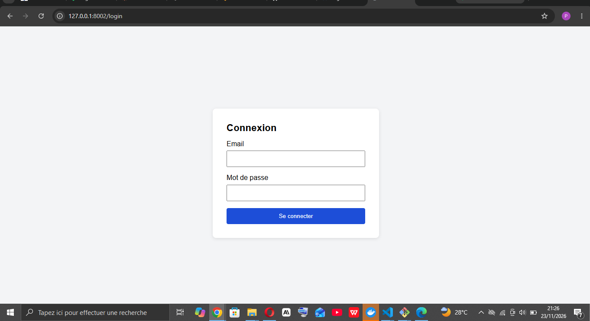
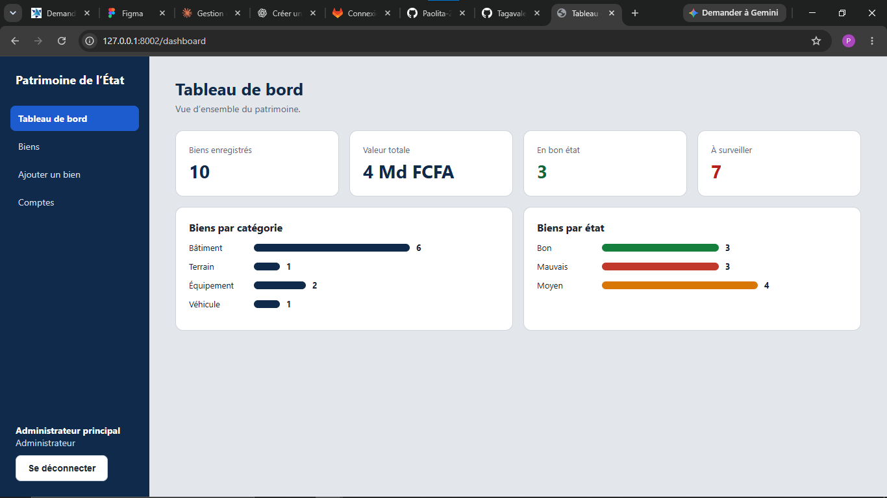
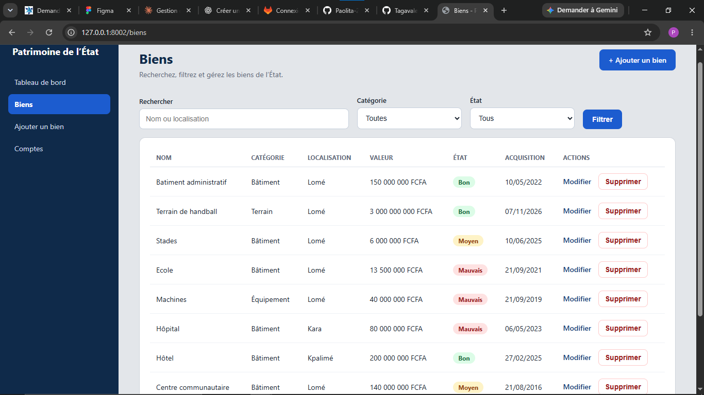
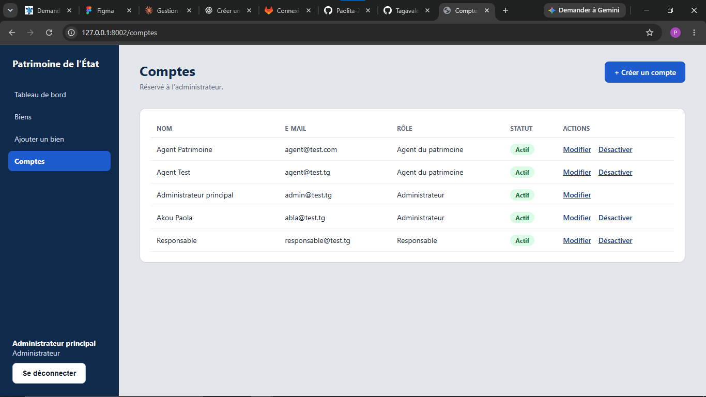

# Gestion du patrimoine de l'État

Application web de gestion du patrimoine de l'État, construite en
architecture micro-services avec Laravel, PostgreSQL et Docker.

Elle permet de gérer les biens de l'État (ajout, modification, suppression,
filtres, statistiques) avec trois rôles : administrateur, agent et responsable.

## Architecture

Le projet est composé de 3 applications Laravel indépendantes, qui communiquent entre elles :

| Service | Port | Rôle |
|---|---|---|
| auth-service | 8000 | Connexion, jeton Sanctum, gestion des rôles |
| patrimoine-service | 8001 | Biens, catégories, statistiques (vérifie le jeton) |
| interface-web | 8002 | Pages web (tableau de bord, biens, comptes) |

Base de données : PostgreSQL (Docker, port 5433) avec deux bases séparées :
`base_auth` et `base_patrimoine`.

## Comptes de test

| Rôle | Email | Mot de passe |
|---|---|---|
| Administrateur | admin@test.tg | Test1234! |
| Agent | agent@test.tg | Test1234! |
| Responsable | responsable@test.tg | Test1234! |

## Installation

### Prérequis
- PHP 8.2 ou plus, Composer
- Docker Desktop
- Git

### 1. Récupérer le projet
```bash
git clone https://github.com/Paolita-2209/etat-patrimoine.git
cd etat-patrimoine
```

### 2. Lancer PostgreSQL
```bash
docker compose up -d
```
Cela crée les bases `base_auth` et `base_patrimoine` (port 5433).

### 3. Configurer chaque service

**auth-service** (connexion et comptes) :
```bash
cd auth-service
composer install
cp .env.example .env
php artisan key:generate
php artisan migrate
php artisan db:seed
cd ..
```
La commande `db:seed` crée les 3 comptes de test (voir plus bas).

**patrimoine-service** (biens et catégories) :
```bash
cd patrimoine-service
composer install
cp .env.example .env
php artisan key:generate
php artisan migrate
php artisan db:seed
cd ..
```

**interface-web** (pages) :
```bash
cd interface-web
composer install
cp .env.example .env
php artisan key:generate
cd ..
```

## Captures d'écran

### Connexion


### Tableau de bord


### Liste des biens


### Gestion des comptes
